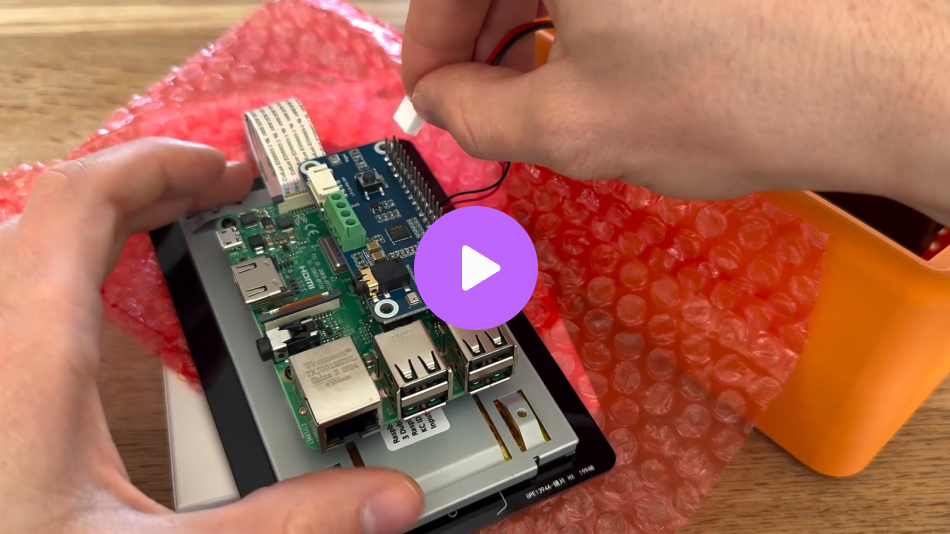

# Mello

A distraction free Spotify speaker for kids

Kids swipe through album covers and tap to play. Parents control the music library from Spotify on their phone.

### Build Video

<a href="https://youtu.be/4tn8OtKkvs8"></a>

## Features

- **Spotify Connect** — Add albums and playlists from your Spotify app, Mello plays them
- **Album carousel** — Large cover art with smooth swipe navigation
- **Simple controls** — Play, pause, skip. That's it
- **Auto-sleep** — Screen turns off after 2 minutes of inactivity
- **Auto-pause** — Music stops after 30 minutes (configurable) to prevent all-day playback
- **Progress memory** — Remembers where each album left off for up to 96 hours
- **Bluetooth** — Connect wireless headphones or speakers
- **WiFi setup** — Creates a hotspot for easy configuration, and gets back onto a known network by itself if WiFi drops
- **Auto-updates** — Pulls latest changes from GitHub nightly
- **No account needed on the device** — Authentication happens via Spotify on your phone

## Hardware

Print the case from [MakerWorld](https://makerworld.com/en/models/2692843-distraction-free-spotify-player-for-kids).

| Part | Link |
|------|------|
| Raspberry Pi 3 Model B | [Amazon](https://www.amazon.com/dp/B07BDR5PDW) |
| Raspberry Pi Touch Display 2 (5") | [Amazon](https://www.amazon.com/dp/B0FMYFKDLZ) |
| WM8960 Audio HAT | [Amazon](https://www.amazon.com/dp/B07KN8424G) |
| 5.1V 3A USB-C Power Supply | [Amazon](https://www.amazon.com/dp/B0CLV6WB4L) |
| USB-C Panel Mount Bushing | [Amazon](https://www.amazon.com/dp/B0CDC1X4BY) |
| Micro SD Card (16GB+) | — |

## Quick Start

### 1. Flash Raspberry Pi OS

Use the [Raspberry Pi Imager](https://www.raspberrypi.com/software/):
- Choose **Raspberry Pi OS Lite (64-bit)**, the current version (Trixie or newer). Spotify Soloist only runs on 64-bit
- Choose a hostname and username (e.g. `mello` / `mello`)
- Configure WiFi and enable SSH

### 2. Install Mello

```bash
ssh <your-user>@<your-hostname>.local
curl -sSL https://raw.githubusercontent.com/emieljanson/mello/main/install.sh | bash
sudo reboot
```

To install without anonymous usage analytics:

```bash
curl -sSL https://raw.githubusercontent.com/emieljanson/mello/main/install.sh | bash -s -- --no-analytics
```

### 3. Connect Spotify

1. Mello's screen shows a QR code: scan it with a phone on the same WiFi and paste your Soloist API key from Spotify (see [Spotify Soloist](#spotify-soloist))
2. Open Spotify on your phone, tap the speaker icon and select "Mello"
3. Start playing — it shows up on the touchscreen

## How It Works

Mello is a Python app using [Slint](https://slint.dev) for the UI and [Spotify Soloist](https://developer.spotify.com/dashboard/soloist), Spotify's own player for speakers, as the Spotify Connect receiver. When you select Mello as a speaker in Spotify and play an album, Soloist handles the audio stream while Mello displays the album art and provides touch controls.

```
Your phone (Spotify app)
    │
    ▼
Spotify Soloist (Spotify Connect player)
    │
    ▼
Mello (Slint UI + touch input)
    │
    ▼
Touchscreen + Speaker
```

Albums and playlists you play are automatically saved to the device. Kids can then browse and play them independently from the touchscreen.

## Settings Menu

> **How to open:** Press and hold the volume button for 3 seconds. There's no gear icon or visible button — the long-press on the volume button is the only way in.

Once open, you'll see a scrollable menu with these sections:

### Connections
- **WiFi** — View saved networks, connect to a new one, or switch. To add a network, tap **+ New network**: Mello creates a "Mello-Setup" hotspot you connect to from your phone, then you pick your WiFi and enter its password. If joining fails, the screen says so and you can simply try again; the networks Mello already knew are kept. If WiFi drops, Mello keeps trying to rejoin a known network by itself
- **Bluetooth** — Pair and connect wireless headphones or speakers. Shows paired devices and nearby discoverable devices
- **Volume levels** — Set separate volume levels (low/mid/high) for the built-in speaker and Bluetooth output
- **Spotify** — A QR code to turn on faster playback (Spotify Soloist), or to change it once it is on (see [Spotify Soloist](#spotify-soloist))

### Playback settings
- **Auto-pause** — How long Mello plays before automatically pausing (15, 30, 60, or 120 minutes). Tap to cycle through options. Default: 30 minutes
- **Remember progress** — How long Mello remembers where each album left off (12, 24, 48, or 96 hours). Tap to cycle. Default: 96 hours

### System
- **Check for updates** — Manually check for and install updates (Mello also updates automatically each night)
- **Reset** — Factory reset: clears all albums, WiFi, Bluetooth, Spotify credentials, and settings. Requires a second tap to confirm

To close the menu, tap the **✕** in the top-right corner.

### Usage Data

During installation, Mello asks if you'd like to share anonymous usage data. This helps improve the project. Only session-level events are collected (play/pause, sleep/wake) — no personal data or music choices. The choice is made once during setup.

## Spotify Soloist

Mello plays Spotify through **Spotify Soloist**, Spotify's own headless Connect client. It needs a 64-bit Raspberry Pi OS and your own API key from Spotify; Mello downloads Soloist from Spotify itself.

Older Mellos played through go-librespot. A speaker that has not switched to Soloist yet keeps working on the last version with go-librespot and stops getting updates until it does: its settings menu says **Update needs Soloist** (tap it for the QR code). A 32-bit speaker cannot run Soloist and says **No updates: needs 64-bit**; reinstall it with the 64-bit Raspberry Pi OS to get updates again.

**Turning it on**

1. On the speaker, open the settings menu (hold the volume button for 3 seconds) and tap **Spotify**
2. Scan the QR code with a phone on the **same WiFi** as Mello. The page explains the steps
3. Get your code from Spotify: with a Spotify Premium account, open [developer.spotify.com/dashboard/soloist](https://developer.spotify.com/dashboard/soloist), accept the terms if asked and generate a key. Every owner needs their own key
4. Paste the code and tap **Connect**. Mello downloads Soloist, switches over and restarts by itself (about half a minute)
5. If Spotify was never connected on this speaker: open Spotify, tap the speaker icon and select "Mello" once

The page only works while the speaker shows the QR code.

**Another Spotify account** (for example your child's, so Mello stops taking over your own phone): your code from Spotify is only the speaker's licence, not who listens. Mello plays with the Spotify account that picked it in the Spotify app (on the same WiFi). To use another account, pick "Mello" from that account's Spotify app.

**New speaker**

After the WiFi step the home screen shows the Mello logo with **Scan with a phone on the same WiFi to connect Spotify** and the QR code, so a new speaker is set up with Soloist straight away. The WiFi page itself only asks for WiFi: it opens in a temporary browser without internet, where you could not fetch a code from Spotify.

**Good to know**

- Soloist builds stop working 90 days after Spotify made them. Mello renews its copy by itself during the nightly update; you do not need to do anything
- Your library and the place you left off in each album are kept when you switch
- Two speakers on the same Spotify account can only play one at a time; that is a Spotify limit
- Soloist can only start an album at its first track, so Mello skips ahead silently to where you were. Deep into a long audiobook this takes a few seconds

## Show Off Your Build

Built a Mello? I'd love to see it! Share a photo on Twitter/X and tag [@emieljanson](https://x.com/emieljanson).

## Contributing

See [CONTRIBUTING.md](CONTRIBUTING.md) for development setup and guidelines.

## Security

See [SECURITY.md](SECURITY.md) for the security policy and responsible disclosure.

## License

[MIT](LICENSE)

## Acknowledgments

- [go-librespot](https://github.com/devgianlu/go-librespot) — Mello's Spotify Connect player before Soloist
- [Slint](https://slint.dev) — UI framework
- [GNU FreeFont](https://www.gnu.org/software/freefont/) — the screen's font (FreeSans Bold)
- [PostHog](https://posthog.com/) — Anonymous usage analytics
